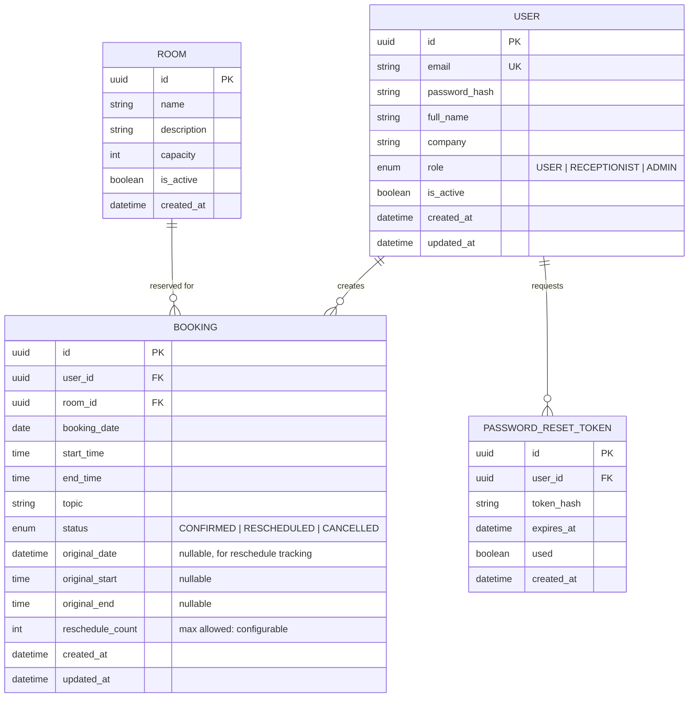

# Meeting Room Reservation System — Implementation Plan

Sistem reservasi ruang meeting berbasis web, self-hosted via Docker, dengan 3 role (User, Receptionist, Administrator), calendar grid view, conflict detection di level database, dan fitur export (Excel + PDF).

## Tech Stack

| Layer | Technology | Rationale |
|:---|:---|:---|
| **Framework** | Next.js 15 (App Router) | SSR, Server Actions, API Routes, standalone Docker output |
| **Language** | TypeScript | Type safety end-to-end |
| **Database** | PostgreSQL 16 | `btree_gist` exclusion constraints untuk prevent overlapping bookings |
| **ORM** | Prisma | Type-safe queries, migrations, seeding |
| **Auth** | NextAuth.js v5 (Auth.js) | Credential-based auth, session management, RBAC |
| **Validation** | Zod | Server + client side validation |
| **Calendar** | Custom CSS Grid component | Full control over styling, no heavy deps |
| **Export Excel** | ExcelJS | Generate `.xlsx` files server-side |
| **Export PDF** | jsPDF + jsPDF-AutoTable | Generate styled PDF reports server-side |
| **Styling** | Vanilla CSS (CSS Modules) | Scoped, performant, no utility framework |
| **Containerization** | Docker + Docker Compose | PostgreSQL + Next.js app in one compose stack |
| **Password Hashing** | bcrypt | Industry standard |

---

## Database Schema



> [!IMPORTANT]
> **Overlap Prevention**: Menggunakan PostgreSQL `EXCLUDE USING GIST` constraint pada tabel `BOOKING` agar konflik jadwal mustahil terjadi bahkan pada concurrent requests. Ini merupakan database-level enforcement, bukan hanya application-level check.

---

## Proposed Changes

### 1. Project Initialization & Config

#### [NEW] `package.json`
Project dependencies dan scripts.

#### [NEW] `next.config.mjs`
Konfigurasi Next.js dengan `output: 'standalone'` untuk Docker production image yang lean.

#### [NEW] `tsconfig.json`
TypeScript configuration.

#### [NEW] `.env.example`
Template environment variables (DATABASE_URL, NEXTAUTH_SECRET, etc.)

---

### 2. Docker & Infrastructure

#### [NEW] `Dockerfile`
Multi-stage build: deps → builder → runner. Non-root user, standalone output, ~150MB final image.

#### [NEW] `docker-compose.yml`
Services:
- `db`: PostgreSQL 16 with persistent volume
- `app`: Next.js app, auto-runs Prisma migrations on startup

#### [NEW] `docker-compose.dev.yml`
Development override with hot-reload, exposed DB ports.

---

### 3. Database & ORM (Prisma)

#### [NEW] `prisma/schema.prisma`
Full schema dengan models: `User`, `Room`, `Booking`, `PasswordResetToken`.

#### [NEW] `prisma/migrations/`
Auto-generated migrations termasuk:
- `btree_gist` extension
- `EXCLUDE USING GIST` constraint pada bookings
- Indexes pada frequently-queried columns

#### [NEW] `prisma/seed.ts`
Seed data: default admin account, default meeting room.

---

### 4. Authentication & Authorization

#### [NEW] `src/lib/auth.ts`
NextAuth.js v5 configuration — credentials provider, session callbacks, JWT strategy.

#### [NEW] `src/middleware.ts`
Route protection middleware — redirect unauthenticated users, enforce role-based access.

#### [NEW] `src/lib/auth-utils.ts`
Helper functions: `hashPassword`, `verifyPassword`, `generateResetToken`, `isAuthorized`.

---

### 5. Core Library & Utilities

#### [NEW] `src/lib/prisma.ts`
Singleton Prisma client (prevents connection exhaustion in dev).

#### [NEW] `src/lib/validations.ts`
Zod schemas: `loginSchema`, `registerSchema`, `bookingSchema`, `rescheduleSchema`, `userManagementSchema`.

#### [NEW] `src/lib/date-utils.ts`
Date/time helpers: overlap checking, business hours validation, reschedule deadline calc.

#### [NEW] `src/lib/export.ts`
Server-side export utilities (Excel via ExcelJS, PDF via jsPDF).

---

### 6. API Routes (Server Actions & Route Handlers)

#### [NEW] `src/app/api/auth/[...nextauth]/route.ts`
NextAuth catch-all route.

#### [NEW] `src/app/api/bookings/route.ts`
`GET` (list bookings), `POST` (create booking) — with conflict detection.

#### [NEW] `src/app/api/bookings/[id]/route.ts`
`PUT` (reschedule), `DELETE` (cancel) — with reschedule deadline enforcement.

#### [NEW] `src/app/api/bookings/export/route.ts`
`GET` — Generate Excel/PDF export of bookings (for Receptionist/Admin).

#### [NEW] `src/app/api/users/route.ts`
`GET` (list users), `POST` (create user) — Admin only.

#### [NEW] `src/app/api/users/[id]/route.ts`
`PUT` (update user), `DELETE` (deactivate user) — Admin only.

#### [NEW] `src/app/api/users/export/route.ts`
`GET` — Generate Excel/PDF export of user list (Admin only).

#### [NEW] `src/app/api/auth/reset-password/route.ts`
`POST` — Request password reset dan process reset.

---

### 7. Pages & Layouts

#### [NEW] `src/app/layout.tsx`
Root layout: metadata, fonts (Inter via Google Fonts), global CSS, session provider.

#### [NEW] `src/app/page.tsx`
Landing/redirect — authenticated users go to dashboard, others go to login.

#### [NEW] `src/app/(auth)/login/page.tsx`
Login page — email + password, link to register, link to forgot password.

#### [NEW] `src/app/(auth)/register/page.tsx`
Registration page — full name, email, company, password.

#### [NEW] `src/app/(auth)/forgot-password/page.tsx`
Password reset request page.

#### [NEW] `src/app/(auth)/reset-password/page.tsx`
Password reset form (with token validation).

#### [NEW] `src/app/(auth)/layout.tsx`
Auth pages layout — centered card, gradient background.

#### [NEW] `src/app/(dashboard)/layout.tsx`
Dashboard layout — sidebar navigation, top bar with user info.

#### [NEW] `src/app/(dashboard)/dashboard/page.tsx`
Main dashboard — role-based: upcoming bookings (User), today's schedule (Receptionist), system stats (Admin).

#### [NEW] `src/app/(dashboard)/bookings/page.tsx`
Booking management — User: my bookings list, create new. Receptionist: all bookings.

#### [NEW] `src/app/(dashboard)/bookings/new/page.tsx`
New booking form — date picker, time range, topic, company (auto-filled).

#### [NEW] `src/app/(dashboard)/bookings/[id]/page.tsx`
Booking detail — view, reschedule, cancel.

#### [NEW] `src/app/(dashboard)/calendar/page.tsx`
**Calendar Grid View** — Weekly/daily view showing all bookings. Color-coded by status. Receptionist & Admin access.

#### [NEW] `src/app/(dashboard)/users/page.tsx`
User management — Admin only. CRUD users, role assignment, export.

#### [NEW] `src/app/(dashboard)/reports/page.tsx`
Reports page — Monthly report generation, export to Excel/PDF.

#### [NEW] `src/app/(dashboard)/profile/page.tsx`
User profile — change password, update info.

---

### 8. UI Components

#### [NEW] `src/components/ui/Button.tsx` + `Button.module.css`
Reusable button: variants (primary, secondary, danger, ghost), sizes, loading state.

#### [NEW] `src/components/ui/Input.tsx` + `Input.module.css`
Form input with label, error states, icons.

#### [NEW] `src/components/ui/Modal.tsx` + `Modal.module.css`
Dialog/modal component with overlay, animations, and portal rendering.

#### [NEW] `src/components/ui/Card.tsx` + `Card.module.css`
Content card with header, body sections.

#### [NEW] `src/components/ui/Badge.tsx` + `Badge.module.css`
Status badges (Confirmed, Rescheduled, Cancelled).

#### [NEW] `src/components/ui/Toast.tsx` + `Toast.module.css`
Toast notification system (success, error, warning, info).

#### [NEW] `src/components/ui/Select.tsx` + `Select.module.css`
Custom styled select/dropdown.

#### [NEW] `src/components/ui/DataTable.tsx` + `DataTable.module.css`
Sortable, paginated data table for lists.

#### [NEW] `src/components/layout/Sidebar.tsx` + `Sidebar.module.css`
Collapsible sidebar navigation, role-based menu items.

#### [NEW] `src/components/layout/TopBar.tsx` + `TopBar.module.css`
Top navigation bar with user avatar, logout, notifications.

#### [NEW] `src/components/calendar/WeeklyCalendar.tsx` + `WeeklyCalendar.module.css`
Grid-based weekly calendar: time slots (Y-axis) × days (X-axis), booking cards positioned by time, hover details.

#### [NEW] `src/components/calendar/DailyCalendar.tsx` + `DailyCalendar.module.css`
Single-day view with hourly slots, detailed booking info.

#### [NEW] `src/components/calendar/CalendarNavigation.tsx`
Week/day navigation, date picker, view mode toggle.

#### [NEW] `src/components/booking/BookingForm.tsx`
Create/edit booking form with real-time availability check.

#### [NEW] `src/components/booking/BookingCard.tsx`
Booking summary card for lists and calendar.

#### [NEW] `src/components/booking/ConflictDialog.tsx`
Popup dialog shown when booking conflicts detected.

#### [NEW] `src/components/booking/RescheduleForm.tsx`
Reschedule form with deadline validation.

---

### 9. Global Styles & Design System

#### [NEW] `src/app/globals.css`
Design tokens (CSS custom properties), base styles, animations, typography.

Design approach:
- **Dark mode first** — dengan glassmorphism elements
- **Color palette**: Deep navy/slate backgrounds, teal/cyan accents, warm amber highlights
- **Typography**: Inter (Google Fonts)
- **Micro-animations**: Subtle fade-ins, slide transitions, hover effects
- **Responsive**: Mobile-first, breakpoints at 768px dan 1024px

---

## Security Measures

| Concern | Solution |
|:---|:---|
| **Password storage** | bcrypt hashing (12 rounds) |
| **SQL injection** | Prisma parameterized queries |
| **XSS** | React's built-in escaping + CSP headers |
| **CSRF** | NextAuth.js built-in CSRF protection |
| **Session** | JWT with httpOnly cookies, short expiry |
| **Rate limiting** | API route rate limiting middleware |
| **Input validation** | Zod schemas on both client & server |
| **Auth bypass** | Middleware route protection + server-side role checks |
| **Booking conflicts** | Database-level exclusion constraint (impossible to bypass via API) |
| **Reschedule abuse** | Server-side deadline enforcement (≥1 day before) |
| **Docker** | Non-root user, minimal Alpine image |

---

## Design Philosophy

Mengambil inspirasi dari:
- **Dark-mode enterprise dashboards** (seperti Linear, Vercel Dashboard)
- **Glassmorphism** pada cards dan modals (backdrop-blur, subtle borders)
- **Depth & layering** — bukan flat design, tapi juga tidak over-the-top
- **Micro-interactions** — smooth transitions pada hover, page changes, dan form submissions
- **Data-dense but clean** — calendar view yang informatif tapi tidak overwhelming

---

## User Review Required

> [!IMPORTANT]
> **Default Admin Account**: Sistem akan di-seed dengan admin default (`admin@system.local` / `Admin@12345`). Password ini HARUS diganti setelah first deployment.

> [!IMPORTANT]
> **No Email Service**: Karena ini self-hosted, fitur "forgot password" akan menggunakan mekanisme token-based dimana Admin bisa generate reset link untuk user (bukan email otomatis). Apakah ini acceptable, atau kamu mau ada integrasi SMTP juga?

> [!WARNING]
> **Redis**: Berdasarkan analisis requirements, Redis **tidak diperlukan** untuk saat ini. Session management menggunakan JWT (stateless), dan tidak ada kebutuhan caching atau job queue yang signifikan. Ini menyederhanakan deployment. Jika ke depannya butuh rate limiting yang lebih robust atau real-time features, Redis bisa ditambahkan.

## Open Questions

> [!IMPORTANT]
> **Jam Operasional**: Apakah ada batasan jam operasional ruang meeting? (misal: hanya bisa di-book jam 08:00-18:00) atau 24/7?

> [!IMPORTANT]
> **Durasi Minimum/Maximum**: Apakah ada durasi minimum (misal: 30 menit) atau maksimum (misal: 4 jam) untuk satu booking?

> [!IMPORTANT]
> **Hari Libur**: Apakah perlu ada mekanisme untuk block tanggal-tanggal tertentu (hari libur nasional, maintenance, dll)?

---

## Folder Structure

```
appointment-scheduler-web/
├── docker-compose.yml
├── docker-compose.dev.yml
├── Dockerfile
├── .dockerignore
├── .env.example
├── .gitignore
├── next.config.mjs
├── package.json
├── tsconfig.json
├── prisma/
│   ├── schema.prisma
│   ├── seed.ts
│   └── migrations/
├── public/
│   └── favicon.ico
└── src/
    ├── middleware.ts
    ├── app/
    │   ├── globals.css
    │   ├── layout.tsx
    │   ├── page.tsx
    │   ├── (auth)/
    │   │   ├── layout.tsx
    │   │   ├── login/page.tsx
    │   │   ├── register/page.tsx
    │   │   ├── forgot-password/page.tsx
    │   │   └── reset-password/page.tsx
    │   ├── (dashboard)/
    │   │   ├── layout.tsx
    │   │   ├── dashboard/page.tsx
    │   │   ├── bookings/
    │   │   │   ├── page.tsx
    │   │   │   ├── new/page.tsx
    │   │   │   └── [id]/page.tsx
    │   │   ├── calendar/page.tsx
    │   │   ├── users/page.tsx
    │   │   ├── reports/page.tsx
    │   │   └── profile/page.tsx
    │   └── api/
    │       ├── auth/[...nextauth]/route.ts
    │       ├── bookings/
    │       │   ├── route.ts
    │       │   ├── [id]/route.ts
    │       │   └── export/route.ts
    │       ├── users/
    │       │   ├── route.ts
    │       │   ├── [id]/route.ts
    │       │   └── export/route.ts
    │       └── auth/
    │           └── reset-password/route.ts
    ├── components/
    │   ├── ui/
    │   │   ├── Button.tsx / Button.module.css
    │   │   ├── Input.tsx / Input.module.css
    │   │   ├── Modal.tsx / Modal.module.css
    │   │   ├── Card.tsx / Card.module.css
    │   │   ├── Badge.tsx / Badge.module.css
    │   │   ├── Toast.tsx / Toast.module.css
    │   │   ├── Select.tsx / Select.module.css
    │   │   └── DataTable.tsx / DataTable.module.css
    │   ├── layout/
    │   │   ├── Sidebar.tsx / Sidebar.module.css
    │   │   └── TopBar.tsx / TopBar.module.css
    │   ├── calendar/
    │   │   ├── WeeklyCalendar.tsx / WeeklyCalendar.module.css
    │   │   ├── DailyCalendar.tsx / DailyCalendar.module.css
    │   │   └── CalendarNavigation.tsx
    │   └── booking/
    │       ├── BookingForm.tsx
    │       ├── BookingCard.tsx
    │       ├── ConflictDialog.tsx
    │       └── RescheduleForm.tsx
    └── lib/
        ├── prisma.ts
        ├── auth.ts
        ├── auth-utils.ts
        ├── validations.ts
        ├── date-utils.ts
        └── export.ts
```

---

## Verification Plan

### Automated Tests
```bash
# Build & type check
npm run build

# Lint
npm run lint
```

### Manual Verification
1. **Docker Compose up** — pastikan semua services start tanpa error
2. **Registration & Login flow** — register user baru, login, verify session
3. **Booking creation** — buat booking, verify muncul di calendar
4. **Conflict detection** — coba book di waktu yang sudah terisi, verify popup conflict muncul
5. **Reschedule** — reschedule booking, verify deadline enforcement (≥1 hari sebelum)
6. **Calendar view** — verify grid calendar menampilkan bookings dengan benar
7. **Export** — download Excel dan PDF, verify data correctness
8. **User management** — Admin CRUD users, verify role enforcement
9. **Password reset** — request reset, verify token-based flow
10. **Responsive design** — test di berbagai viewport sizes
